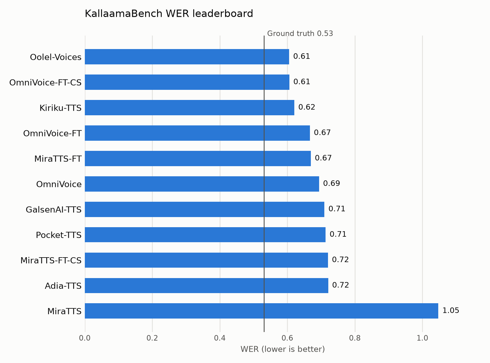

# KallaamaBench 🎙️

**The first open TTS benchmark for the Wolof language**

> *Kallaama* — "language" in Wolof

KallaamaBench provides a standardised evaluation protocol for Wolof TTS systems.
Participants synthesise audio from 1602 text prompts; the evaluation script
scores submissions against hidden reference data.

---

## TTS Leaderboard

*Last updated: 2026-10-30*

| Rank | System | MOS↑ | UTMOS↑ | WER↓ | SNR↑ (dB) | RTF↓ | SpkSim↑ | F0 Corr↑ | Date |
|:---:|---|---|:---:|:---:|:---:|:---:|:---:|:---:|---|
| 1 | *Oolel-Voices* | **4.17** | **3.01** | **0.61** | 58.20 | 0.64 | 0.51 | 0.78 | 2026-05-25 |
| 1 | *OmniVoice-FT* | **4.17** | 2.68 | 0.67 | **67.69** | 0.15 | 0.57 | **0.85** | 2026-07-14 |
| 3 | *OmniVoice-FT-CS* | 4.10 | 2.78 | **0.61** | 65.05 | 0.15 | 0.63 | 0.84 | 2026-07-14 |
| 4 | *MiraTTS-FT* | 3.71 | 2.50 | 0.67 | 59.68 | 0.18 | 0.47 | 0.79 | 2026-07-14 |
| 5 | *OmniVoice* | 3.56 | 2.84 | 0.69 | 58.64 | 0.15 | **0.67** | **0.85** | 2026-05-25 |
| 6 | *GalsenAI-TTS* | 3.36 | 2.81 | 0.71 | 60.37 | 0.34 | 0.58 | 0.82 | 2026-05-25 |
| 7 | *MiraTTS-FT-CS* | 3.23 | 2.50 | 0.72 | 57.88 | 0.18 | 0.46 | 0.81 | 2026-07-14 |
| 8 | *Adia-TTS* | 3.02 | 2.45 | 0.72 | 61.27 | 1.42 | - | - | 2026-05-25 |
| - | *Kiriku-TTS* | - | 2.87 | 0.62 | 63.65 | **0.02** | 0.26 | 0.41 | 2026-10-29 |
| - | *Pocket-TTS* | - | 2.38 | 0.71 | 56.19 | 0.87 | 0.38 | 0.84 | 2026-10-29 |
| - | *MiraTTS* | - | 2.37 | 1.05 | 53.16 | 0.18 | 0.34 | 0.77 | 2026-05-25 |

Systems are ranked by MOS; systems with equal MOS share a rank. Systems that have not been
through human evaluation yet have no rank and are listed by WER.

### WER leaderboard

WER is the automatic metric most correlated with MOS
([KallaamaBench paper](https://openreview.net/pdf?id=KhMwIWEZuB)), so it is the best proxy for
systems without human evaluation. The vertical line is the WER of the real recordings.

<picture>
  <source media="(prefers-color-scheme: dark)" srcset="assets/wer_leaderboard_dark.png">
  
</picture>

---

## Metrics

| Metric | Tool | What it measures |
|---|---|---|
| **MOS** ↑ | Native Wolof speakers | Human-evaluated naturalness (1–5) |
| **UTMOS** ↑ | UTMOSv2 | Predicted naturalness (1–5) |
| **WER** ↓ | Omnilingual ASR + jiwer | Intelligibility |
| **SNR** ↑ | PyAnnote Brouhaha | Signal cleanliness (dB) |
| **SpkSim** ↑ | ECAPA-TDNN cosine similarity | Voice similarity to reference speaker |
| **F0Corr** ↑ | pYIN + Pearson correlation | Pitch dynamics match |
| **RTF** ↓ | Self-reported | Speed of synthesis |

MOS of top-5 systems is evaluated monthly by native Wolof speakers if funding is available.

---

## Repository layout

```
kallaamabench/
├── assets/                   # WER leaderboard plots shown in this README
│
├── data/
│   ├── corpus.csv            # Metadata of Wolof test utterances (filename|transcription|speaker|gender)
│   ├── groundtruth.npz       # Precomputed speaker embeddings + F0 stats
│   └── references/           # Reference audio samples used for voice cloning (WAV, 16 kHz mono)
│
├── inference/                # One inference script per evaluated system
│   ├── adia/  galsenai/  oolel/
│   ├── omnivoice/  mira/  kiriku/   # configured with YAML files in configs/
│   └── pocket-tts/           # Not tracked: clone the Pocket-TTS repository here (see Reproducing the baselines)
│
├── results/                  # JSON files containing evaluation results (groundtruth/ = real recordings)
│
├── utils/
│   ├── evaluation/           # Python scripts used for MOS evaluation
│   ├── hf-utils/             # Python script to download data from Hugging Face
│   └── leaderboard/          # Script that draws the WER leaderboard plot
│
├── README.md
├── SUBMISSION_FORMAT.md      # Instructions to submit a new TTS model to the leaderboard
├── evaluate.py               # Evaluation script
├── pyproject.toml            # Evaluator dependencies, managed with uv
├── uv.lock                   # Locked dependency versions
└── requirements.txt          # Core pins for reference (does not include omnilingual-asr, pyannote or Brouhaha)
```

---

## Quick start

### 1. Install dependencies

The evaluator runs on Python 3.12 and is managed with [uv](https://docs.astral.sh/uv/):

```bash
uv sync
export HF_TOKEN=your_huggingface_token   # Brouhaha (pyannote/brouhaha) is gated: accept its conditions on the Hub
```

`uv sync` installs everything `evaluate.py` needs, including Omnilingual ASR, pyannote.audio and Brouhaha.

### 2. Synthesise the test sentences

Write one 16 kHz mono 16-bit PCM wav per corpus row to `<submission>/audio/`, named as in `corpus.csv`:

```python
import os
import time

import pandas as pd
import soundfile as sf
import torchaudio
from tqdm import tqdm

from my_tts_model import TTSModel

submission_dir = "submissions/my_tts_model"
os.makedirs(os.path.join(submission_dir, "audio"), exist_ok=True)

model  = TTSModel.load("my_checkpoint")
corpus = pd.read_csv("data/corpus.csv", sep="|", header=0, on_bad_lines="skip", dtype=str)

rtf_values = []
for _, row in tqdm(corpus.iterrows(), total=len(corpus), desc="Generating audio"):
    start_time = time.time()
    audio, sr  = model.synthesise(row["transcription"])            # (1, T) tensor
    audio      = torchaudio.functional.resample(audio, sr, 16000)
    rtf_values.append((time.time() - start_time) / (audio.shape[-1] / 16000))
    sf.write(os.path.join(submission_dir, "audio", row["filename"]),
             audio.squeeze(0).numpy(), 16000, subtype="PCM_16")
```

### 3. Create `metadata.json` in the submission folder

```json
{
    "team"            : "MyTeam",
    "system"          : "FastSpeech2 + HiFi-GAN",
    "submission_date" : "2026-05-25",
    "rtf"             : 0.038,
    "contact"         : "me@example.com"
}
```

### 4. Validate locally on the test set

```bash
uv run python evaluate.py evaluate \
    --submission    submissions/my_tts_model/ \
    --groundtruth   data/groundtruth.npz \
    --corpus        data/corpus.csv \
    --output        results/my_tts_model/results_my_tts_model.json
```

A GPU is recommended: the script loads UTMOSv2, omniASR_LLM_1B, Brouhaha and ECAPA.

### 5. Submit

Zip your submission and open a **New Submission** issue in this repository.
See [SUBMISSION_FORMAT.md](SUBMISSION_FORMAT.md) for details.


---

## Data policy

- The test set audio (1602 recordings) is released only in its compressed Numpy format.
- `data/corpus.csv` and `data/groundtruth.npz` are public.
- `groundtruth.npz` contains speaker embeddings (192-dim) and F0 histogram statistics only — raw audio cannot be reconstructed.

---

## License

This work is licensed under a [Creative Commons Attribution 4.0 International License (CC BY 4.0)](https://creativecommons.org/licenses/by/4.0/).

[](https://creativecommons.org/licenses/by/4.0/)

You are free to share and adapt under the following terms:

- **Attribution** — You must give appropriate credit, provide a link to the license, and indicate if changes were made.
